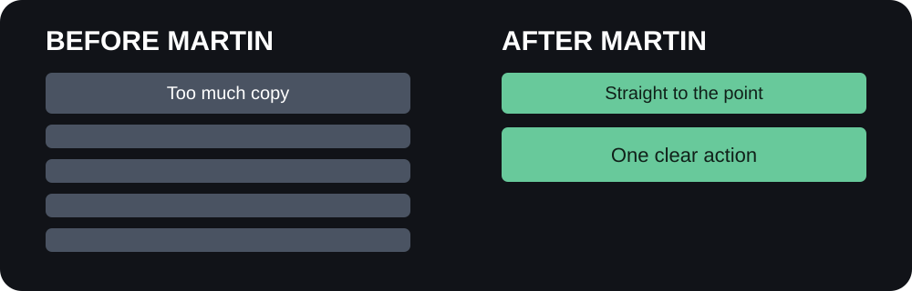

# ✂️ Martin

## Your landing page isn't a novel.

**An open-source Claude Code + Codex skill that turns feature-heavy websites into value-first landing pages, cuts fluff, and edits your actual code.**



### The origin

Martin Tale (@MartinTale) told a friend his landing pages had too much copy and would work better if he cut it roughly in half and got straight to the point. This skill turns that advice into an automated coding workflow. A playful homage, not an official endorsement by Martin Tale.

### What it does

Martin first identifies the **one outcome your visitor actually wants**, then inspects your website, inventories sections, judges their value and **edits the source code**. It compresses vague copy, merges duplicate feature grids, removes filler FAQs and unsupported proof, and improves hierarchy while protecting product facts, pricing, accessibility, SEO and functionality.

### Install in Claude Code

Clone/download this repository, then:

```bash
mkdir -p ~/.claude/skills/martin
cp -R /path/to/martin-skill/. ~/.claude/skills/martin/
```

Open Claude Code in your website project and run `/martin`, or ask it to use the Martin skill.

### Install in Codex

```bash
mkdir -p ~/.agents/skills/martin
cp -R /path/to/martin-skill/. ~/.agents/skills/martin/
```

In Codex: `Use the martin skill to simplify this landing page and apply the changes.` Invocation varies by version. Project-local installations use `.claude/skills/martin/` or `.agents/skills/martin/` respectively. Copy **all files**, including references.

### Modes

| Mode | Behavior |
|---|---|
| `fix` (default) | Actually edits website code |
| `audit` | Recommendations only |
| `brutal` | Aggressively cuts redundancy with safeguards |
| `copy` | Text changes only |
| `hero` | Hero clarity and size |
| `mobile` | Mobile hierarchy and clutter |

Ask for a mode in plain language, e.g. `Use Martin in brutal mode on my homepage`. Modes are skill instructions, not separate binaries.

### Value first. Features second.

Visitors do not want to memorize your feature list. They want to know what changes for them. Martin clusters related features around meaningful customer outcomes, leads with the strongest defensible benefit and supports it with real examples or product visuals.

| Before: features | After: value |
|---|---|
| AI prioritization, smart labels, calendar sync | Know what to work on next. |
| Reports, dashboards, charts | See what is working without digging. |
| Automations, templates, triggers | Stop repeating the same busywork. |

These examples are illustrative; Martin must verify product capabilities before using claims. **One primary outcome and two or three supporting benefits** is a useful starting point, not a cap on essential information.

Read the [value-first playbook](references/value-first.md).

### Martin's five decisions

**KEEP** necessary content. **COMPRESS** useful but wordy material. **MERGE** overlapping sections. **MOVE** useful content to a better position. **DELETE** repetition, filler and unsupported decoration.

For every section Martin asks: What visitor question does this answer? Is it already answered? Is the information concrete and true? Does it help someone understand, trust or act? What would be lost if removed?

### Favorite targets

- “Revolutionize your workflow” headlines that explain nothing.
- Three feature grids saying the same thing.
- Twelve feature cards and no clear reason to care.
- Paragraphs that repeat the heading.
- Giant heroes hiding the actual product.
- Empty statistics and unverifiable testimonials.
- FAQs written only to make the page longer.

### What Martin protects

Pricing, plan limitations, genuine proof, technical constraints, legal information, accessibility, navigation, forms, analytics, SEO and unrelated user edits.

**The 50% rule is a challenge, not a quota.** A complex B2B site can need a lot of information. A $5 utility might need one screen. Martin's job is to preserve meaning, not win a word-count competition.

### Example output (illustrative)

```text
Martin has spoken: Your visitors came for a product, not a trilogy.
Changed: compressed hero, merged two grids, removed empty stats.
Before → after: 1,520 → 810 words (measured).
Checks: build passed; mobile and desktop inspected.
Preserved: pricing, integrations, CTA and legal footer.
```

These are illustrative numbers, not an actual site audit.

### Research and testing

Built around NN/g research on scannable writing, Baymard findings on navigation and product discovery, and WCAG 2.2. Read [research and limitations](references/research.md), [decision framework](references/decision-framework.md), [value-first playbook](references/value-first.md), [UX principles](references/ux-principles.md), [quality gates](references/quality-gates.md) and [10 evaluation scenarios](tests/scenarios.md).

No evidence here proves that cutting 50% of words doubles conversions. A/B tests are required to measure conversion impact. The skill is research-informed but **not yet validated against real websites**. Browser tooling is needed for screenshot-based visual QA.

### Contributing

PRs welcome for real before/after examples, evaluation results, source-backed UX improvements and better safeguards. Avoid invented performance claims or universal quotas.

### License

MIT. See [LICENSE](LICENSE).

**Martin has spoken. You built 27 features. Now tell people why they should care.**
