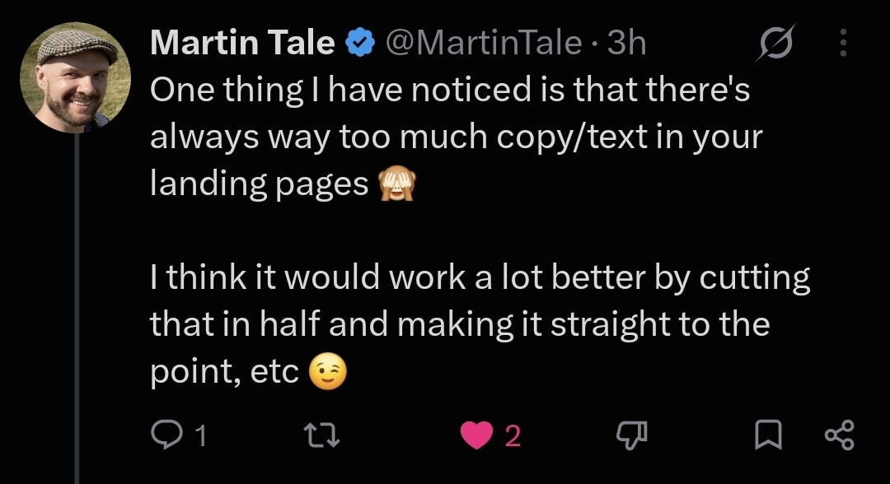
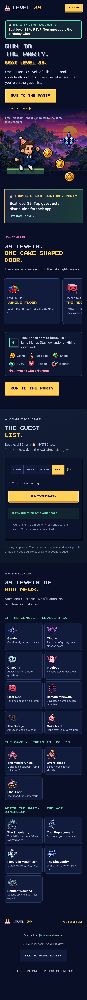
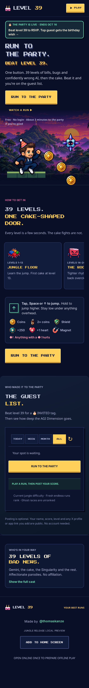

# ✂️ Martin

Your landing page isn't a novel. Martin maps the page, then edits the source.

```bash
git clone https://github.com/apwn/martin-skill ~/.claude/skills/martin
```

Codex: clone to `~/.agents/skills/martin`. Then open the site repo and run `/martin`.

## Origin

Martin Tale ([@MartinTale](https://x.com/MartinTale)) told me my landing pages had too much copy and would work better if I cut it roughly in half and got straight to the point.



This skill turns that advice into an automated coding workflow. A playful homage, not an official endorsement by Martin Tale.

## What it does

Structure first. A merge cannot grow the hero (about 0.75 of a 1440x900 desktop screen, one 390x844 mobile screen, with headline, offer and CTA above the fold). Timers and badges attach under the CTA, not as their own row. After edits: screenshot, critique the fold and orphans, fix up to twice. The report includes a per-section height table. Pricing, proof, legal, accessibility and SEO stay.

| Mode | Behavior |
|---|---|
| `fix` (default) | Edits the website code |
| `audit` | Recommendations only |
| `brutal` | Cuts harder at repetition, same safeguards |
| `copy` | Text only |
| `hero` | Hero clarity and size |
| `mobile` | Mobile hierarchy and clutter |

`Use Martin in brutal mode on my homepage`.

## Example: [level39.fun](https://level39.fun)

Same offer, four times, then two mobile screens of enemies. Collapse the catalog. Keep the route. Banner gone, cast collapsed, hero a bit smaller than the original.

<table>
  <tr>
    <td align="center"><br>Before</td>
    <td align="center"><br>After</td>
  </tr>
</table>

Landing mobile: 5.31 → 3.55 screens. Desktop: 3.63 → 2.86.

On the birthday page the prize block merged into the hero and the standalone countdown became one line under Play.


Birthday hero: 1.05 → 0.48 mobile screens. Page: 4.62 → 3.23.

Self-review caught four of its own issues: hero growth from the invite card, padding leaking to mobile, a misaligned countdown, and a headline wrap. Tests and build passed.

MIT. See [LICENSE](LICENSE).

Research, limits and the decision notes are in [references/](references/).
